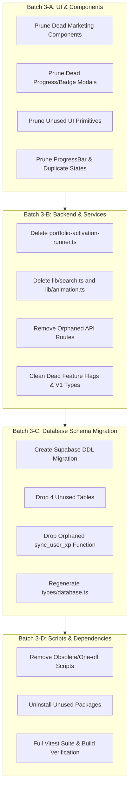

# Dead Code and Technical Debt Audit: Prodily

**Audit branch:** `phase-3` (audit recorded in `f44293f`)
**Audit date:** 2026-10-31
**Last updated:** 2026-11-13
**Status:** Done. Batches 3-A to 3-D landed in PR #79 (merged 2026-11-09). The deferred items were handled on branch `chore/post-phase3-cleanup` (not merged yet). See §8 for what landed where and §9 for candidates not acted on.
**Scope exclusions:** `08-IMPLEMENTATION-PLAN.md`, `audit/` folder.

"Phase 3" in this document means the dead-code batches 3-A to 3-D. It is not plan Phase 3 (PR-14 to PR-20, platform safety) in [`../08-IMPLEMENTATION-PLAN.md`](../08-IMPLEMENTATION-PLAN.md), which is tracked in [`ROADMAP.md`](ROADMAP.md).

---

## Executive Summary

A static analysis and cross-check of the `prodily-monorepo` (`apps/web/`, `scripts/`, `supabase/`, root tooling) found the items below. The original findings are kept; each table now has an **Outcome** column. Several findings were wrong or were overruled, and the outcome says so.

The audit identified:
- **22 frontend components and hooks** flagged as dead (marketing sections and cards, badge, leaderboard and progress components, UI primitives, feedback components, notification widgets, one animation hook). Two of them (`NotificationBell`, `NotificationToast`) were false positives.
- **Dead backend modules**: the disabled `portfolio-activation-runner.ts`, legacy search and animation helpers, the admin barrel.
- **4 API routes** flagged as orphaned. Two were removed in PR #79, `/api/waitlist` on `chore/post-phase3-cleanup`, and `/api/cron/retry-failed` was a false positive and stays.
- **4 unused tables and 1 RPC**, dropped by migration `20261031000001`.
- **6 scripts**, of which 5 were tracked and removed; the sixth is gitignored.
- **7 NPM packages** flagged; 5 removed net, because CI needs `@emnapi/core` and `@emnapi/runtime`.
- **5 feature flags** flagged; 2 retired, 3 kept.

---

## 1. Frontend: Components, Primitives, and Hooks

### 1.1 Unused Marketing Page Sections & Helper Cards
The live marketing landing page is `apps/web/app/(marketing)/page.tsx`. The audit first listed every section below as `components/marketing/<name>.tsx`; the sections actually live in `apps/web/components/marketing/sections/`. Paths here are corrected.

| File Path | Description | Outcome |
|---|---|---|
| `apps/web/components/marketing/sections/community.tsx` | Legacy community section | Removed on `chore/post-phase3-cleanup` |
| `apps/web/components/marketing/sections/experience.tsx` | Legacy experience section | **Kept** by owner decision (pinned by `marketing-homepage-phase0c` and `b12b-marketing-server-components` tests) |
| `apps/web/components/marketing/sections/faq.tsx` | Legacy FAQ section, duplicate of `home-faq.tsx` | Removed in PR #79 (`6876fb7`) |
| `apps/web/components/marketing/sections/journey.tsx` | Legacy journey section | **Kept** by owner decision (pinned by tests, as above) |
| `apps/web/components/marketing/sections/journey-timeline.tsx` | Sub-component of the journey section | **Kept** by owner decision (pinned by tests, as above) |
| `apps/web/components/marketing/sections/testimonials.tsx` | Static marketing testimonials | Removed on `chore/post-phase3-cleanup` (also dropped from the `b11c` exempt list) |
| `apps/web/components/marketing/feature-card.tsx` | Unused feature card helper | Removed in PR #79 (`6876fb7`) |
| `apps/web/components/marketing/testimonial-card.tsx` | Unused testimonial card helper | Removed in PR #79 (`6876fb7`) |

Also removed on `chore/post-phase3-cleanup` (not in the original audit): `components/marketing/product-mockup/lesson-card-preview.tsx`, `module-card-preview.tsx` and `xp-row-preview.tsx`. `product-mockup/skill-radar.tsx` is live and kept.

### 1.2 Unused Badge, Progress, and Leaderboard Components

| File Path | Description | Outcome |
|---|---|---|
| `apps/web/components/badges/BadgeNotification.tsx` | Toast popover for earned badges | Removed in PR #79 (`6876fb7`) |
| `apps/web/components/progress/BadgeShowcaseCard.tsx` | Standalone badge showcase card (the audit gave the path as `components/badges/`) | Removed on `chore/post-phase3-cleanup` |
| `apps/web/components/leaderboard/ProfileComparisonModal.tsx` | Profile comparison modal, never wired to rows | Removed in PR #79 (`6876fb7`). Its dead `onCompare` prop and Compare button in `LeaderboardTable` went on `chore/post-phase3-cleanup` |
| `apps/web/components/progress/ProgressSectionDropdown.tsx` | Progress section dropdown | Removed in PR #79 (`6876fb7`) |

Also removed on `chore/post-phase3-cleanup` (not in the original audit): `components/progress/CapstonesOverviewCard.tsx` and `components/notifications/DashboardNotificationsWidget.tsx`.

### 1.3 Unused Feedback & Notification Variants

| File Path | Description | Outcome |
|---|---|---|
| `apps/web/components/feedback/error-state.tsx` | Duplicate of `components/ui/error-state.tsx` | Removed in PR #79 (`6876fb7`) |
| `apps/web/components/feedback/success-state.tsx` | Unused success state | Removed in PR #79 (`35dfe84`) |
| `apps/web/components/notifications/NotificationBell.tsx` | Flagged as an orphaned bell | **Kept**: false positive, mounted in `components/layout/Topbar.tsx` |
| `apps/web/components/notifications/NotificationToast.tsx` | Flagged as an unreferenced toast | **Kept**: false positive, mounted in `components/layout/Topbar.tsx` |

### 1.4 Unused UI Primitives & Hooks

| File Path | Description | Outcome |
|---|---|---|
| `apps/web/components/ui/accordion.tsx` | Radix accordion wrapper | Removed in PR #79 (`6876fb7`) |
| `apps/web/components/ui/badge.tsx` | Generic badge primitive | Removed in PR #79 (`35dfe84`) |
| `apps/web/components/ui/card.tsx` | Generic card primitive | Removed in PR #79 (`35dfe84`) |
| `apps/web/components/ui/select.tsx` | Generic select primitive | Removed in PR #79 (`35dfe84`) |
| `apps/web/components/ui/toast.tsx` | Generic toast primitive | Removed in PR #79 (`35dfe84`) |
| `apps/web/hooks/useXpAnimation.ts` | XP increment animation hook | Removed in PR #79 (`35dfe84`) |

---

## 2. Backend: Modules, Services, and Route Handlers

### 2.1 Dead Modules and Abandoned Services

| File Path | Details | Outcome |
|---|---|---|
| `apps/web/lib/campaigns/portfolio-activation-runner.ts` | Blocked by `PORTFOLIO_ACTIVATION_DISABLED_REASON`; no callers | Shrunk in `306853e`, deleted in `6876fb7` (PR #79). `lib/campaigns/` no longer exists |
| `apps/web/lib/search.ts` | Legacy `searchLessons()` over a static array. Search is the compiler-built `content/dist/search-index.json`, served by `/api/search-index` and scored client-side; no search library is used | Removed in PR #79 (`306853e`) |
| `apps/web/lib/animation.ts` | Framer-motion transition constants, no imports | Removed in PR #79 (`306853e`) |
| `apps/web/lib/admin/index.ts` | Admin barrel re-export | Removed in PR #79 (`306853e`) |
| `lib/admin/cohort-service.ts` `deleteCohort`, `lib/admin/analytics-service.ts` `getCohortAnalytics` | Reported as uncalled | Not found: neither function appears in the code or in `git log -S` history. No action |
| `apps/web/lib/xp/duplicate-analysis.ts` (+ test) | Not in the original audit. Analysis helper for the finished B8-D/B8-E XP work | Removed on `chore/post-phase3-cleanup` |

### 2.2 Orphaned & Deprecated API Route Handlers

| Route | Method | Description | Outcome |
|---|---|---|---|
| `apps/web/app/api/dev/send-test-email/route.ts` | `POST` | Dev-only duplicate of `/api/admin/emails/test-send` | Removed in PR #79 (`306853e`) |
| `apps/web/app/api/cron/retry-failed/route.ts` | `POST` | Flagged as deprecated and unscheduled | **Kept**: false positive. Used by the cron heartbeat (`lib/monitoring/cron-heartbeat.ts`), the admin system service (`lib/admin/system-service.ts`) and the manual `retry-failed-emails` job in `.github/workflows/notification-scheduler.yml` |
| `apps/web/app/api/waitlist/route.ts` | `POST` | Pre-launch waitlist handler; no UI posts to it | Removed on `chore/post-phase3-cleanup`, with its `proxy.ts` entries, the `waitlist_signup` event, `trackWaitlistSignup()`, `buildWaitlistConfirmationEmail()` and the waitlist types. The `public.waitlist` table drop is **held** in `supabase/migrations/pending-approval/20261112000001_drop_waitlist_table.sql` until the owner exports the rows |
| `apps/web/app/api/admin/system/storage-cleanup/route.ts` | `POST` | Orphaned admin endpoint | Removed in PR #79 (`306853e`) |

---

## 3. Database: Unused Tables and Stored Procedures

| Database Object | Type | Finding | Outcome |
|---|---|---|---|
| `public.weekly_leaderboard_snapshots` | Table | No reads or writes; leaderboards aggregate XP directly | Dropped by `20261031000001` (PR #79, `ce95199`) |
| `public.bookmarks` | Table | No reads or writes | Dropped by `20261031000001`. Its account-deletion entry was removed on `chore/post-phase3-cleanup` |
| `public.email_dead_letter` | Table | Permanent failures stay in `email_queue` (status `'dead_letter'`) | Dropped by `20261031000001`; the processor insert was removed in `6876fb7` |
| `public.user_notification_timeline` | Table | Notification history is served by `in_app_notifications` | Dropped by `20261031000001`. Its retention rule and account-deletion entry were removed on `chore/post-phase3-cleanup` |
| `public.sync_user_xp(uuid)` | RPC | No callers; the `update_user_xp_and_level()` trigger sums XP | Dropped by `20261031000001` |
| `public.waitlist` | Table | Not in the original audit. Its route is gone | Drop **held** in `pending-approval/20261112000001` (owner exports rows first) |

The migration shipped without a rollback. `supabase/migrations/rollback/20261031000001_phase3_drop_unused_tables.down.sql` was added on `chore/post-phase3-cleanup`: structure only, rows are not restored, and `sync_user_xp` comes back `service_role`-only.

---

## 4. Email Templates & Component Primitives

| File Path | Description | Outcome |
|---|---|---|
| `apps/web/emails/components/ProgressBar.tsx` | Email progress bar, no imports | Removed in PR #79 (`35dfe84`) |
| `apps/web/emails/index.ts` `inactive.resume_learning` | Flagged as a dead template key | **Kept**: the key is still registered and used |
| `apps/web/emails/index.ts` `system.weekly_recap` | Duplicate of `recap.weekly` | Removed in PR #79 (`6876fb7`) |

---

## 5. Repository Scripts & Diagnostics

| Script Path | Reason | Outcome |
|---|---|---|
| `scripts/compiler/tests/test-all-shapes.ts` | Targets a missing `content/v2/test-shapes.md` | Removed in PR #79 (`710c174`) |
| `scripts/compiler/tests/compare-v1-v2.ts` | Empty comparison stub | Removed in PR #79 (`710c174`), with the `test:parity` npm script |
| `apps/web/scripts/send-jolly-recovery-email.ts` | One-off recovery script with a hardcoded recipient | Gitignored and never tracked, so no commit removes it. Delete the local copy by hand if it exists |
| `scripts/diagnostics/xp-duplicates.ts` | One-off B8-D diagnostic | Removed in PR #79 (`710c174`) |
| `scripts/backup/postgrest-data-export.ts` | Pre-B8-E stopgap exporter | Removed in PR #79 (`710c174`) |
| `scripts/benchmark-concurrency.ts` | Old signup rate-limiter stress test | Removed in PR #79 (`710c174`), with the `benchmark` npm script |

`scripts/compiler/` and `scripts/brand/generate-assets.ts` use `unified`, `remark-*`, `unist-util-visit`, `mermaid` and `sharp`. Those packages stay.

---

## 6. Dependencies & Feature Flags

### 6.1 Unused NPM Dependencies in `apps/web/package.json`

| Package | Outcome |
|---|---|
| `bail` | Removed in `710c174` |
| `hermes-parser` | Removed in `710c174` |
| `lightningcss` | Removed in `710c174` |
| `mdn-data` | Removed in `710c174` |
| `@types/mdast` | Removed in `710c174` |
| `@emnapi/core` | Removed in `710c174`, **restored** to `devDependencies` in `18e0e0b` (CI needs it) |
| `@emnapi/runtime` | Removed in `710c174`, **restored** to `devDependencies` in `18e0e0b` (CI needs it) |

Net: 5 packages removed. On `chore/post-phase3-cleanup`, `@types/qrcode` moved from `dependencies` to `devDependencies`.

### 6.2 Dead Feature Flags in `lib/notifications/feature-flags/`
The audit gave the path as `lib/feature-flags.ts`; the defaults live in `apps/web/lib/notifications/feature-flags/service.ts` and the type in `types.ts` beside it.

| Flag | Outcome |
|---|---|
| `ACHIEVEMENT_EMAIL_ENABLED` | Retired on `chore/post-phase3-cleanup` (default, type, admin toggle). Stored values are cleaned by the held `pending-approval/20261112000002_remove_retired_notification_flags.sql`; run it only after the code is deployed |
| `PORTFOLIO_EMAILS_ENABLED` | Retired on `chore/post-phase3-cleanup`, same as above |
| `WEEKLY_RECAP_ENABLED` | **Kept**: required by tests and the admin toggles |
| `MARKETING_EMAILS_ENABLED` | **Kept**: required by tests and the admin toggles |
| `SCHEDULER_ENABLED` | **Kept**: required by tests and the admin toggles |

### 6.3 Deprecated V1 Types in `apps/web/types/index.ts`

| Type | Outcome |
|---|---|
| `ParsedLesson`, `MarketingModule` | Removed in PR #79 (`6876fb7`) |
| `LessonMeta`, `QuizQuestion`, `FlashcardItem` | Kept in PR #79, then removed on `chore/post-phase3-cleanup` after `knip` showed no users |
| `WaitlistFormValues`, `WaitlistPayload` (with `ROLE_OPTIONS`, `RoleOption`) | Removed on `chore/post-phase3-cleanup` with the waitlist route |
| `SkillRadarDemoData` | **Kept**: used by `config/content.ts` for the live marketing radar |

The `knip` sweep on `chore/post-phase3-cleanup` also removed `ApiSuccess`, `ApiError`, `FeatureItem` and `TestimonialItem`, and made `CompiledLessonRef`, `CompiledFlashcard` and `CompiledGlossaryEntry` module-private.

---

## 7. Phase 3 Execution Roadmap (as planned)

The batches were planned in this order. §8 records what actually landed.

### Safety Invariants During Deletion
1. Every removal is followed by `npm run typecheck` (from `apps/web`).
2. The Vitest suite stays green at each batch boundary.
3. Table drops are checked for foreign-key dependencies first.

---

## 8. Outcome

### PR #79 (merged 2026-11-09 as `0b04fd0`)

| Commit | What landed |
|---|---|
| `f44293f` | This audit and the Phase 3 roadmap |
| `35dfe84` | Batch 3-A part 1: `ui/badge`, `ui/card`, `ui/select`, `ui/toast`, `feedback/success-state`, `hooks/useXpAnimation`, `emails/components/ProgressBar` |
| `306853e` | Batch 3-B: `lib/search.ts`, `lib/animation.ts`, `lib/admin/index.ts`, `/api/dev/send-test-email`, `/api/admin/system/storage-cleanup`; campaign runner shrunk |
| `ce95199` | Batch 3-C: migration `20261031000001_phase3_drop_unused_tables.sql` |
| `710c174` | Batch 3-D: 5 tracked scripts, 7 packages (2 later restored) |
| `6876fb7` | Batch 3-A part 2 (`BadgeNotification`, `feedback/error-state`, `ProfileComparisonModal`, `feature-card`, `sections/faq`, `testimonial-card`, `ProgressSectionDropdown`, `ui/accordion`), campaign runner deleted, `system.weekly_recap` key, `types/database.ts` aligned with the dropped tables, processor and notifications admin service stopped touching them, `MarketingModule` and `ParsedLesson` removed, test allowlists updated |
| `18e0e0b` | `@emnapi/core` and `@emnapi/runtime` restored to `devDependencies` |

Deviations from the plan in PR #79: `/api/cron/retry-failed` and its workflow job were kept (false positive); `/api/waitlist` was not removed; `NotificationBell` and `NotificationToast` were kept (false positive); `experience`, `journey`, `journey-timeline`, `community` and `testimonials` sections were not removed; three of the five flags were kept; the migration had no rollback file.

### Branch `chore/post-phase3-cleanup` (not merged yet)

- `/api/waitlist` and everything that served it; `public.waitlist` drop held in `pending-approval/20261112000001`.
- `ACHIEVEMENT_EMAIL_ENABLED` and `PORTFOLIO_EMAILS_ENABLED` retired; stored-value cleanup held in `pending-approval/20261112000002` (run after deploy).
- Components removed: `sections/community`, `sections/testimonials`, the three product-mockup previews, `DashboardNotificationsWidget`, `BadgeShowcaseCard`, `CapstonesOverviewCard`. `experience`, `journey` and `journey-timeline` stay by owner decision.
- `lib/xp/duplicate-analysis.ts` and its test removed.
- `knip` sweep: dead types, `config/content.ts` constants, `LEVEL_TITLES` and `getTitleForXp`, the `BrandMarkProdigy` alias, unused imports in 7 production files, the `LeaderboardTable` `onCompare` prop, the stale `ProfileComparisonModal` ESLint entry.
- Retention rule and account-deletion entries for the dropped tables removed.
- Rollback added for `20261031000001`; notes added to the `rollback/20261018000001_*` files that still reference `sync_user_xp`.
- `@types/qrcode` moved to `devDependencies`.

Full entries are in [`CHANGELOG.md`](CHANGELOG.md).

---

## 9. Remaining candidates (not acted on)

Found by `knip` and grep on 2026-11-12. None of these were removed; each needs a check before it goes.

- About 139 exports are used only inside their own file (`knip` "unused exports"). Most can lose the `export` keyword rather than be deleted.
- Lib functions with no callers outside their own file, tests included:
  - `lib/academy/lessons-db.ts`: `getUserLessonProgress`, `getUserCompletedLessonIds`
  - `lib/lessons-completion-service.ts`: `isLessonUnlockedByOrderNumber`, `getFirstLockedLessonIndex`
  - `lib/skillRadar.ts`: `getSkillRadarHistory`
  - `lib/streaks/streaks.ts`: `isSameDay`
  - `lib/notifications/`: `getEventDefinition` (`events/index.ts`), `filterReadyQueueItems` (`queue/helpers.ts`), `createTimelineRecordFromQueueItem` (`timeline/helpers.ts`), `computeAnalyticsAggregate` (`analytics/index.ts`), `getNotificationConfig` (`config.ts`), `QUEUE_CONSTANTS` (`constants.ts`)
  - `lib/auth.ts`: `isProfileComplete`
  - `lib/brand.ts`: `brandTitle`, `productCopy`
  - `lib/design/tokens.ts`: `DURATION`, `EASING`, `BREAKPOINTS`, `Z_INDEX`
- `@typescript-eslint/parser` is imported by `lib/__tests__/b8g-typed-db-migration.test.ts` but is not declared in `apps/web/package.json`; it is only installed transitively. Add it as an explicit `devDependency`.
- The privacy page (`app/(marketing)/privacy/page.tsx`) still lists "lesson bookmarks" as collected data, but the `bookmarks` table is dropped. Changing it is an owner and legal call.
