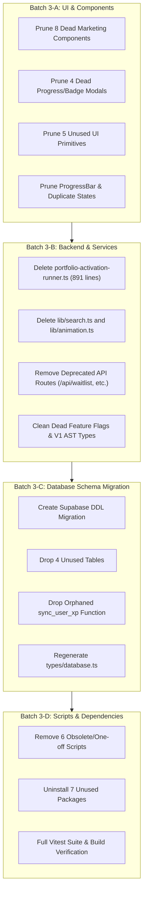

# Comprehensive Dead Code & Technical Debt Audit — Prodily PM Academy

**Branch:** `phase-3`  
**Date:** October 31, 2026  
**Status:** 🟡 Pending Execution (Audit Complete, Phased Pruning Plan Ready)  
**Execution Methodology:** Multi-Agent Pipeline (Static Analysis + Specialized Subagents: Frontend, Backend/API, Systems/Scripts/Dependencies)  
**Scope Exclusions:** `08-IMPLEMENTATION_PLAN.md`, `audit/` folder.

---

## Executive Summary

As part of the **Phase 3** repository modernization, a comprehensive static analysis and cross-verification audit was conducted across the entire `prodily-monorepo` (`apps/web/`, `scripts/`, `supabase/`, and root tooling).

The audit identified:
- **22 Dead Frontend Components & Hooks**: 8 obsolete marketing sections/cards, 4 dead badge/leaderboard/progress modals, 4 unused UI primitives, 2 dead feedback components, 2 duplicate notification widgets, and 1 dead animation hook.
- **4 Dead Backend Modules / 930+ Dead Service Lines**: 891 lines in `portfolio-activation-runner.ts` permanently gated off by `PORTFOLIO_ACTIVATION_DISABLED_REASON`, plus legacy search and animation helper modules.
- **4 Deprecated / Orphaned API Routes**: Dev-only email sender (`/api/dev/send-test-email`), deprecated queue retry endpoint (`/api/cron/retry-failed`), defunct pre-launch waitlist handler (`/api/waitlist`), and orphaned storage cleanup handler (`/api/admin/system/storage-cleanup`).
- **4 Unused Database Tables & 1 Orphaned Stored Procedure**: Tables with zero application reads/writes (`weekly_leaderboard_snapshots`, `bookmarks`, `email_dead_letter`, `user_notification_timeline`) and 1 unused database RPC (`sync_user_xp`).
- **6 Obsolete or One-off Maintenance Scripts**: Broken test fixtures, hardcoded PII email recovery scripts, and historical pre-migration diagnostics.
- **7 Unused NPM Dependencies & 8 Deprecated V1 AST Types**: Orphaned AST parsers and legacy compiler data structures.
- **5 Unreferenced Feature Flags**: Dead toggles in `DEFAULT_FEATURE_FLAGS` never consulted by application runtime.

---

## 1. Frontend: Components, Primitives, and Hooks

### 1.1 Unused Marketing Page Sections & Helper Cards
The live marketing landing page at `apps/web/app/(marketing)/page.tsx` renders: `Hero`, `SocialProof`, `CurriculumPreview`, `LearningExperience`, `ProductPhilosophy`, `PricingSection`, and `FinalCta`. The following components in `apps/web/components/marketing/` have **zero callers** across the repository:

| File Path | Description | Risk | Phase 3 Recommendation |
|---|---|---|---|
| [`apps/web/components/marketing/community.tsx`](file:///d:/Prodily/apps/web/components/marketing/community.tsx) | Legacy community section | Low | Prune in Batch 3-A |
| [`apps/web/components/marketing/experience.tsx`](file:///d:/Prodily/apps/web/components/marketing/experience.tsx) | Legacy experience section (superseded by `LearningExperience`) | Low | Prune in Batch 3-A |
| [`apps/web/components/marketing/faq.tsx`](file:///d:/Prodily/apps/web/components/marketing/faq.tsx) | Legacy FAQ accordion section | Low | Prune in Batch 3-A |
| [`apps/web/components/marketing/journey.tsx`](file:///d:/Prodily/apps/web/components/marketing/journey.tsx) | Legacy journey section | Low | Prune in Batch 3-A |
| [`apps/web/components/marketing/journey-timeline.tsx`](file:///d:/Prodily/apps/web/components/marketing/journey-timeline.tsx) | Sub-component for legacy journey | Low | Prune in Batch 3-A |
| [`apps/web/components/marketing/testimonials.tsx`](file:///d:/Prodily/apps/web/components/marketing/testimonials.tsx) | Static marketing testimonials | Low | Prune in Batch 3-A |
| [`apps/web/components/marketing/feature-card.tsx`](file:///d:/Prodily/apps/web/components/marketing/feature-card.tsx) | Unused feature card helper | Low | Prune in Batch 3-A |
| [`apps/web/components/marketing/testimonial-card.tsx`](file:///d:/Prodily/apps/web/components/marketing/testimonial-card.tsx) | Unused testimonial card helper | Low | Prune in Batch 3-A |

### 1.2 Unused Badge, Progress, and Leaderboard Components
Following the ADR-009 modularization of `/progress` and `/badges`:

| File Path | Description | Risk | Phase 3 Recommendation |
|---|---|---|---|
| [`apps/web/components/badges/BadgeNotification.tsx`](file:///d:/Prodily/apps/web/components/badges/BadgeNotification.tsx) | Toast notification popover for earned badges (unreferenced; in-app notification center handles unlocks) | Low | Prune in Batch 3-A |
| [`apps/web/components/badges/BadgeShowcaseCard.tsx`](file:///d:/Prodily/apps/web/components/badges/BadgeShowcaseCard.tsx) | Standalone badge showcase card; `/badges` uses inline grid cards | Low | Prune in Batch 3-A |
| [`apps/web/components/leaderboard/ProfileComparisonModal.tsx`](file:///d:/Prodily/apps/web/components/leaderboard/ProfileComparisonModal.tsx) | Modal to compare two learner profiles; never hooked into leaderboard rows | Low | Prune in Batch 3-A |
| [`apps/web/components/progress/ProgressSectionDropdown.tsx`](file:///d:/Prodily/apps/web/components/progress/ProgressSectionDropdown.tsx) | Dropdown selector for progress sections; `/progress` tab layout is static | Low | Prune in Batch 3-A |

### 1.3 Unused Feedback & Notification Variants
| File Path | Description | Risk | Phase 3 Recommendation |
|---|---|---|---|
| [`apps/web/components/feedback/error-state.tsx`](file:///d:/Prodily/apps/web/components/feedback/error-state.tsx) | Duplicate error state component; canonical shared component is `apps/web/components/ui/error-state.tsx` | Low | Prune in Batch 3-A |
| [`apps/web/components/feedback/success-state.tsx`](file:///d:/Prodily/apps/web/components/feedback/success-state.tsx) | Duplicate success state; unused across application | Low | Prune in Batch 3-A |
| [`apps/web/components/notifications/NotificationBell.tsx`](file:///d:/Prodily/apps/web/components/notifications/NotificationBell.tsx) | Orphaned standalone bell; canonical implementation is `NotificationCenter.tsx` in app header | Low | Prune in Batch 3-A |
| [`apps/web/components/notifications/NotificationToast.tsx`](file:///d:/Prodily/apps/web/components/notifications/NotificationToast.tsx) | Unreferenced floating notification toast | Low | Prune in Batch 3-A |

### 1.4 Unused UI Primitives & Hooks
| File Path | Description | Risk | Phase 3 Recommendation |
|---|---|---|---|
| [`apps/web/components/ui/accordion.tsx`](file:///d:/Prodily/apps/web/components/ui/accordion.tsx) | Radix accordion wrapper; 0 imports | Low | Prune in Batch 3-A |
| [`apps/web/components/ui/badge.tsx`](file:///d:/Prodily/apps/web/components/ui/badge.tsx) | Generic badge primitive; 0 imports (app uses direct Tailwind badges) | Low | Prune in Batch 3-A |
| [`apps/web/components/ui/card.tsx`](file:///d:/Prodily/apps/web/components/ui/card.tsx) | Generic card primitive; 0 imports | Low | Prune in Batch 3-A |
| [`apps/web/components/ui/select.tsx`](file:///d:/Prodily/apps/web/components/ui/select.tsx) | Generic select primitive; 0 imports | Low | Prune in Batch 3-A |
| [`apps/web/components/ui/toast.tsx`](file:///d:/Prodily/apps/web/components/ui/toast.tsx) | Generic toast primitive; 0 imports | Low | Prune in Batch 3-A |
| [`apps/web/hooks/useXpAnimation.ts`](file:///d:/Prodily/apps/web/hooks/useXpAnimation.ts) | Framer motion XP increment hook; 0 imports | Low | Prune in Batch 3-A |

---

## 2. Backend: Modules, Services, and Route Handlers

### 2.1 Dead Modules and Abandoned Services
| File Path | Lines | Details | Phase 3 Recommendation |
|---|---|---|---|
| [`apps/web/lib/campaigns/portfolio-activation-runner.ts`](file:///d:/Prodily/apps/web/lib/campaigns/portfolio-activation-runner.ts) | 891 | Blocked by `PORTFOLIO_ACTIVATION_DISABLED_REASON = 'Portfolio activation runner disabled pending activation review'`. 0 callers across the repository. Broadcast service replaced ad-hoc campaign runners. | Delete in Batch 3-B. (Frees 891 lines) |
| [`apps/web/lib/search.ts`](file:///d:/Prodily/apps/web/lib/search.ts) | 35 | Legacy search function (`searchLessons()`) querying static array; replaced by `content/dist/search-index.json` and FlexSearch compiler. | Delete in Batch 3-B |
| [`apps/web/lib/animation.ts`](file:///d:/Prodily/apps/web/lib/animation.ts) | 48 | Framer-motion transition constants (`fadeVariants`, `slideVariants`); 0 imports in app. | Delete in Batch 3-B |
| [`apps/web/lib/admin/index.ts`](file:///d:/Prodily/apps/web/lib/admin/index.ts) | 12 | Barrel re-export file for admin services; consumers import directly from service files. | Delete in Batch 3-B |
| `apps/web/lib/admin/cohort-service.ts` -> `deleteCohort` | 24 | Uncalled method; cohort management in admin has no UI/route for hard deletion. | Prune function export |
| `apps/web/lib/admin/analytics-service.ts` -> `getCohortAnalytics` | 15 | Stub returning mock/empty cohort analytics; uncalled by admin UI. | Prune function export |

### 2.2 Orphaned & Deprecated API Route Handlers
| Route | Method | Description | Phase 3 Recommendation |
|---|---|---|---|
| [`apps/web/app/api/dev/send-test-email/route.ts`](file:///d:/Prodily/apps/web/app/api/dev/send-test-email/route.ts) | `POST` | Dev-only duplicate of email testing. Production admin uses `/api/admin/emails/test-send`. | Remove route folder in Batch 3-B |
| [`apps/web/app/api/cron/retry-failed/route.ts`](file:///d:/Prodily/apps/web/app/api/cron/retry-failed/route.ts) | `POST` | Deprecated cron endpoint. Retry processing is consolidated inside `/api/cron/process-email-queue`. Not scheduled in `notification-scheduler.yml`. | Remove route folder in Batch 3-B |
| [`apps/web/app/api/waitlist/route.ts`](file:///d:/Prodily/apps/web/app/api/waitlist/route.ts) | `POST` | Pre-launch waitlist submission route. `/waitlist` redirects directly to `/signup`. Pre-launch waitlist phase is concluded. | Remove route folder in Batch 3-B |
| [`apps/web/app/api/admin/system/storage-cleanup/route.ts`](file:///d:/Prodily/apps/web/app/api/admin/system/storage-cleanup/route.ts) | `POST` | Orphaned admin endpoint; cleanup is executed via scheduled cron job. | Remove route folder in Batch 3-B |

---

## 3. Database: Unused Tables and Stored Procedures

Cross-referencing `supabase/migrations/` and `apps/web/types/database.ts` against all queries in `apps/web/`:

| Database Object | Type | Status & Usage Analysis | Phase 3 Recommendation |
|---|---|---|---|
| `public.weekly_leaderboard_snapshots` | Table | Created in `20260805000006`. No inserts, updates, or reads exist anywhere in application code or cron jobs. Leaderboard queries dynamically aggregate XP directly. | Drop via SQL migration in Batch 3-C |
| `public.bookmarks` | Table | Created in `20260728000002`. Bookmark functionality was superseded by lesson progress and review queues. Zero active reads or writes in the app. | Drop via SQL migration in Batch 3-C |
| `public.email_dead_letter` | Table | Created in `20260806000001`. The email queue engine marks failures with `status = 'failed'` and logs to `system_errors` rather than transferring rows to `email_dead_letter`. | Drop via SQL migration in Batch 3-C |
| `public.user_notification_timeline` | Table | Created in `20260806000001`. Notification history is served directly by `in_app_notifications`. Zero application queries touch this table. | Drop via SQL migration in Batch 3-C |
| `public.sync_user_xp(uuid)` | Stored Procedure / RPC | Defined in `20260805000001`. Zero callers in app or scripts. Trigger `update_user_xp_and_level()` handles automated XP summation. | Drop via SQL migration in Batch 3-C |

---

## 4. Email Templates & Component Primitives

| File Path | Description | Phase 3 Recommendation |
|---|---|---|
| [`apps/web/emails/components/ProgressBar.tsx`](file:///d:/Prodily/apps/web/emails/components/ProgressBar.tsx) | Email progress bar component. 0 imports across all email templates in `apps/web/emails/`. | Prune in Batch 3-A |
| `apps/web/emails/index.ts` -> `inactive.resume_learning` | Dead template key in email registry pointing to undefined or obsolete template. | Clean registry in Batch 3-A |
| `apps/web/emails/index.ts` -> `system.weekly_recap` | Legacy recap entry superseded by `recap.weekly`. | Clean registry in Batch 3-A |

---

## 5. Repository Scripts & Diagnostics

The following scripts in `scripts/` and `apps/web/scripts/` are obsolete, broken, or one-off relics:

| Script Path | Reason for Pruning | Phase 3 Recommendation |
|---|---|---|
| [`scripts/compiler/tests/test-all-shapes.ts`](file:///d:/Prodily/scripts/compiler/tests/test-all-shapes.ts) | Broken test targeting non-existent `content/v2/test-shapes.md`. | Delete in Batch 3-D |
| [`scripts/compiler/tests/compare-v1-v2.ts`](file:///d:/Prodily/scripts/compiler/tests/compare-v1-v2.ts) | Empty comparison stub. Compiler v2 is authoritative. | Delete in Batch 3-D |
| [`apps/web/scripts/send-jolly-recovery-email.ts`](file:///d:/Prodily/apps/web/scripts/send-jolly-recovery-email.ts) | One-off recovery script containing hardcoded recipient email and auth tokens. | Delete immediately in Batch 3-D |
| [`scripts/diagnostics/xp-duplicates.ts`](file:///d:/Prodily/scripts/diagnostics/xp-duplicates.ts) | One-off diagnostic script used during B8-D migration. Task completed. | Delete in Batch 3-D |
| [`scripts/backup/postgrest-data-export.ts`](file:///d:/Prodily/scripts/backup/postgrest-data-export.ts) | Stopgap data exporter used prior to B8-E migration. Task completed. | Delete in Batch 3-D |
| [`scripts/benchmark-concurrency.ts`](file:///d:/Prodily/scripts/benchmark-concurrency.ts) | Local stress test script for old signup rate limiter. Superseded by Vitest concurrency tests. | Delete in Batch 3-D |

*Note on Compiler & Brand Assets:* `scripts/compiler/` and `scripts/brand/generate-assets.ts` utilize `unified`, `remark-*`, `unist-util-visit`, `mermaid`, and `sharp`. These packages must NOT be removed from dependencies.

---

## 6. Dependencies & Feature Flags

### 6.1 Unused NPM Dependencies in `apps/web/package.json`
The following dependencies have no static or dynamic imports across `apps/web/` and are not required at runtime:
1. `bail`
2. `hermes-parser`
3. `lightningcss`
4. `mdn-data`
5. `@emnapi/core`
6. `@emnapi/runtime`
7. `@types/mdast`

### 6.2 Dead Feature Flags in `lib/feature-flags.ts`
The following feature flags in `DEFAULT_FEATURE_FLAGS` are neither queried in the frontend nor checked in backend services:
- `ACHIEVEMENT_EMAIL_ENABLED`
- `PORTFOLIO_EMAILS_ENABLED`
- `WEEKLY_RECAP_ENABLED`
- `MARKETING_EMAILS_ENABLED`
- `SCHEDULER_ENABLED`

*Action:* Prune from `DEFAULT_FEATURE_FLAGS` and remove dead keys from `FeatureFlag` type in Batch 3-B.

### 6.3 Deprecated V1 AST Types in `apps/web/types/index.ts`
- `ParsedLesson`, `LessonMeta`, `QuizQuestion`, `FlashcardItem` (Superseded by Compiler v2 types in `types/lesson.ts`)
- `WaitlistFormValues`, `WaitlistPayload`
- `MarketingModule`, `SkillRadarDemoData`

*Action:* Prune dead interfaces in Batch 3-B.

---

## 7. Phase 3 Execution Roadmap

To ensure zero regressions, Phase 3 execution will follow this ordered batching:

### Safety Invariants During Deletion:
1. Every component removal must be accompanied by a workspace build check (`npm run build` or `npm run type-check`).
2. Vitest suite (`160 files, 2180 tests`) must remain 100% passing at each batch boundary.
3. Database migration must verify no foreign key dependencies block table drops.

