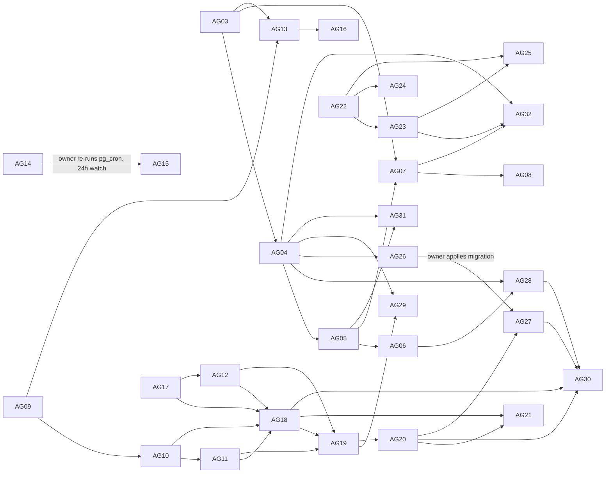

# Prodily roadmap: what is left

**Updated:** 2026-11-13
**Source plan:** [`08-IMPLEMENTATION-PLAN.md`](../08-IMPLEMENTATION-PLAN.md) (PR and finding IDs) and the audit reports in [`audit/`](../audit/).
**Task briefs:** [`tasks/antigravity/`](../tasks/antigravity/README.md), one file per task (AG-01 to AG-34).

This file is the single list of remaining work. It applies the owner decisions below to the original plan. Anything the plan asked for that those decisions rule out is in "Dropped or deferred", with the reason.

## Owner decisions that shape this plan

- Email verification stays OFF.
- Feature flags are ON by default for shipped features.
- Zero budget: free tiers only (Vercel Hobby, Supabase Free, free email tiers, free GitHub Actions minutes). No paid tools.
- No AI grader.
- No dark mode. It is removed, not finished.
- No em-dashes in any copy or docs.
- The capstone threshold experiment stays off until product signs off.

---

## 1. Status snapshot

| Work | Status | Reference |
|---|---|---|
| Phase 0 decisions D1 to D9 | Decided 2026-10-20 | Owner decisions above |
| Phase 1, PR-01 to PR-04 (stop the bleeding) | Done | `01d5915`, PR #64 |
| Google sign-in | Built, flag OFF | `af5bea5` |
| Phase 2, PR-05 to PR-13 (trust and correctness) | Done in code. Owner steps not applied yet | `002fb0f`, PR #73; [`docs/ops/phase2-owner-runbook.md`](ops/phase2-owner-runbook.md) |
| Dead-code cleanup ("Phase 3" batches 3-A to 3-D) | Done | PR #79: `35dfe84`, `306853e`, `ce95199`, `710c174`, `6876fb7` |
| CI fixes after cleanup | Done | `18e0e0b`; PR #82 (`777c36a`, merge `41ce885`) |
| Post-cleanup branch `chore/post-phase3-cleanup` | In review, not merged | Removes `/api/waitlist` and unused components; retires `ACHIEVEMENT_EMAIL_ENABLED` and `PORTFOLIO_EMAILS_ENABLED`; adds `rollback/20261031000001_phase3_drop_unused_tables.down.sql`; holds two cleanup migrations |
| Plan Phase 3, PR-14 to PR-20 (platform safety) | Mostly not started | Milestone M1 below |
| Plan Phase 4, PR-21 to PR-30 (growth foundations) | Not started | Milestone M2 below |
| Plan Phase 5 (scale and strategy) | Not started, later | Milestone M3 below |

Partial work already in place for M1: admin access comes only from `users.is_admin` (PR-18 first bullet); `after()` is used in signup, capstone submit and daily reminder (PR-19 part); the braces advisory is resolved and the audit allowlist is empty (PR-14 last bullet); `deploy-supabase` pushes and verifies migrations (PR-16 part).

---

## 2. Owner-only actions (not for Antigravity)

Do these yourself. Agents must never run them.

### 2.1 Merge the cleanup branch
1. Let CI finish on `chore/post-phase3-cleanup`, review, merge.
2. Check the `deploy-supabase` job on `main` is green, and that `20261031000001_phase3_drop_unused_tables` shows as applied in its "Migration state AFTER push" log.

### 2.2 Phase 2 runbook
Follow [`docs/ops/phase2-owner-runbook.md`](ops/phase2-owner-runbook.md) in this order:
1. (a) Confirm the function region (`apps/web/vercel.json` already pins `bom1`) and record `/api/health` timings.
2. (d) Email capacity count. Free quota stays at 100 a day.
3. (c) Production env check, and confirm `requireEmailVerification` is `false`.
4. (b) pg_cron scheduler with Vault secrets `cron_secret` and `site_url`, then a 24-hour heartbeat watch.
5. (e) Correction email to the 234 PM Fellows, in three batches over three days.
6. (f) Username pre-check, then the username CHECK migration.
7. (g) Lock `public.users`.
8. (h) Confirm CI applied `20261024000001` and `20261024000002`.

### 2.3 Held migrations, in run order
All live in `supabase/migrations/pending-approval/`. Run each in the Supabase SQL editor, then its validation file. Rollbacks are in `pending-approval/rollback/`.

| # | File | Preconditions | Undo |
|---|---|---|---|
| 1 | `admin_backfill_from_admin_emails.sql` (ops snippet) | Only if an admin lost access after Phase 1. Promote by user id, never by email. | Demote with an `UPDATE` |
| 2 | `20261027000001_users_username_check.sql` | Pre-check query returns no rows (runbook f) | `.down.sql` |
| 3 | `20261027000002_lock_public_users.sql` | Phase 2 code is live in production (PR #73 deployed) | `.down.sql` |
| 4 | `20261024000003_schedule_cron_jobs_pg_cron.sql` | Capacity check done; Vault `cron_secret` and `site_url` exist. Re-run once after AG-14 merges (process-broadcasts switches to POST) | `.down.sql` |
| 5 | `20261030000001_cron_heartbeat_deadman.sql` | #4 applied; Vault `cron_alert_webhook_url` exists; **AG-01 merged** (its rollback and validation files do not exist yet) | AG-01 adds it |
| 6 | `20261112000001_drop_waitlist_table.sql` | Cleanup branch deployed; waitlist rows exported (2.4) | `.down.sql` (empty table, no rows) |
| 7 | `20261112000002_remove_retired_notification_flags.sql` | Cleanup branch deployed | `.down.sql` (puts both keys back as `true`) |

Rows 6 and 7 are independent of each other and of rows 2 to 5. Held migrations from AG tasks join this list when they merge, with fixed names: `20261113000001_scrub_dead_letter_auth_links` (AG-02), `20261113000002_before_user_created_allow_signups` (AG-12), `20261113000003_backfill_onboarding_completed` (AG-13, only if the owner count is non-zero; apply before AG-13 deploys), `20261113000004_capstone_review_feedback` (AG-26), `20261113000005_lesson_mastery` (AG-28), `20261113000006_weekly_goal` (AG-29), `20261113000007_leaderboard_weekly_rpc` and `20261113000008_drop_duplicate_indexes` (AG-31), `20261113000010_tighten_contact_friends_policies` (AG-33).

### 2.4 Waitlist export decision
Before running row 6: export `public.waitlist` to CSV outside the repository and note the row count. Decide what happens to it: contact those people once (only if their sign-up consented to that), or delete the export after a fixed date. It is personal data. Never commit it, never put it in `backups/` inside the repo tree.

### 2.5 Dashboard settings
- **Supabase Auth:** keep Confirm email OFF. After AG-12: minimum password length 10, Secure password change ON, and the Before User Created hook (if the free plan offers it). After AG-16: switch to asymmetric JWT signing keys. Confirm Turnstile CAPTCHA is on.
- **Supabase:** check `system_settings` `contactEmail`, `replyToEmail`, `fromEmail` use `prodily.app` (Ops-1.7).
- **Vercel:** env cleanup from runbook (c). After AG-07: create a token and add `VERCEL_TOKEN`, `VERCEL_ORG_ID`, `VERCEL_PROJECT_ID` to GitHub secrets. Keep 308 redirects from the old `prodily.adityagangwani.me` host so certificate links keep working.
- **GitHub:** branch protection on `main` requires a review and the CI checks (PR-14). After AG-08: add `BACKUP_ENCRYPTION_KEY`.
- **Resend:** rotate the API key if it was not rotated after SEC-18 (its prefix is in git history).
- **Search:** verify Google Search Console and Bing Webmaster Tools (free), submit the sitemap after AG-22.
- **Monitoring:** optional free external uptime check on `/api/health` (for example a free uptime monitor). Only if it stays free. After AG-15 removes the GitHub schedule, this is the only alert that still works if pg_cron or the database stops.
- **Retention:** after AG-31 merges, call cleanup as admin (dry run), review counts per rule, then set `RETENTION_DELETE_ENABLED=true` in Vercel. Before AG-31, the flag alone deletes nothing.
- **E2E secrets (PR-14 "tests never use production keys"):** CI `e2e` currently gets production `SUPABASE_SERVICE_ROLE_KEY`, `RESEND_API_KEY` and `CRON_SECRET` at job level (`.github/workflows/ci.yml:133-139`). AG-03 narrows them to steps. Fully separating them needs the staging decision in 2.6; until then, write flows stay self-skipped and `e2e/support/env.ts` refuses the production host.

### 2.6 Sign-offs the tasks wait on
- AG-08: where encrypted backups are stored, retention, who holds the key.
- AG-13: run the read-only onboarding count it gives you; a non-zero result means its held backfill ships first.
- AG-23, AG-24, AG-25: lesson titles and answers, framework list and text, `/about` text.
- AG-28: mastery threshold, grandfathering, certificate rule.
- AG-29: whether a "goal at risk" nudge may send email (recommended: in-app only).
- Staging: whether to create a second free Supabase project for staging (free projects pause after inactivity). Without it, the authenticated E2E and a11y specs keep self-skipping.
- Capstone threshold experiment: stays off until product decides.

---

## 3. Milestones

### M1 Platform safety (plan Phase 3, PR-14 to PR-20, plus two follow-ups)
Goal: real-database tests in CI, ordered releases, backups, visible errors, hardened auth, accessible app.
Tasks AG-01 to AG-21.

### M2 Growth foundations (plan Phase 4, PR-21 to PR-30, filtered)
Goal: content exposed to search and AI, the capstone feedback loop live, learning measured by mastery.
Tasks AG-22 to AG-32. Product changes that need sign-off are marked.

### M3 Scale and strategy (plan Phase 5, filtered; later and optional)
Tasks AG-33 and AG-34 are optional engineering backlogs. The product and market bets are owner decisions, not agent tasks (section 5).

---

## 4. Task list

Size: S under 2 hours, M half a day to 2 days. "Parallel" means safe to run at the same time as other tasks in its wave (see the [task README](../tasks/antigravity/README.md) for waves and file conflicts). "Owner" marks a task that needs an owner action or sign-off.

| ID | Task | Size | Depends on | Parallel | Wave | Closes | Owner |
|---|---|---|---|---|---|---|---|
| AG-01 | Dead-man cron check: rollback, validation, drift test | S | none | merge one at a time (pending README) | 1 | PR-11 follow-up (ENG-01), plan rule 3 | applies migration |
| AG-02 | Scrub one-time auth links from dead-lettered emails | S | none | merge one at a time (pending README) | 1 | ADR-005 gap, SEC-17 (queue part) | runs scrub SQL |
| AG-03 | CI supply-chain hardening | S | none | no (ci.yml) | 1 | PR-14: SEC-10, SEC-20 | branch protection |
| AG-04 | Real-Postgres CI job and grant allowlist | M | AG-03 | no (ci.yml) | 2 | PR-15: ENG-05 part, grant check | |
| AG-05 | pgTAP tests for RLS, RPCs, triggers | M | AG-04 | no (ci.yml) | 3 | PR-15: ENG-05, CQ-33 part | |
| AG-06 | Shared Supabase test fake, remove quiz fallback | M | AG-05 | yes | 4 | PR-15: CQ-32, CQ-33 | |
| AG-07 | Apply migrations before production goes live | M | AG-03, AG-05 | no (ci.yml) | 4 | PR-16: ENG-06 | Vercel token, secrets |
| AG-08 | Nightly encrypted dump and restore drill | M | AG-07 | yes | 5 | PR-16: ENG-07 | sign-off, key, drill |
| AG-09 | Request error hook, client beacon, route timing | M | none | yes | 1 | PR-17: ENG-11 | |
| AG-10 | Admin handlers throw to withRoute | M | AG-09 | yes | 2 | PR-17: CQ-06 | |
| AG-11 | One error envelope, typed client, lint rule | M | AG-10 | no (components) | 3 | PR-17: CQ-30, CQ-13 | |
| AG-12 | Password rules, signup hook, re-auth for destructive actions | M | AG-17 | merge before AG-13 (pending README) | 2 | PR-18: SEC-15, SEC-09, SEC-12 part | dashboard settings |
| AG-13 | Email hook signatures, app_metadata, Origin check | M | AG-03, AG-09 | no (proxy.ts) | 2 | PR-18: SEC-16, SEC-21, SEC-12 part | onboarding count |
| AG-14 | Cron callers use POST | S | none | merge one at a time (pending README) | 1 | PR-18: SEC-12 prep | re-run pg_cron SQL |
| AG-15 | Remove cron GET aliases and GitHub schedule | S | AG-14, owner pg_cron | yes | any | PR-18: SEC-12; runbook (b)6 | 24h heartbeat watch |
| AG-16 | getClaims and a narrower proxy | M | AG-13 | no (proxy.ts) | 3 | PR-19: ENG-03, ENG-04 | JWT signing keys |
| AG-17 | Remove dark mode | M | none | no (globals.css) | 1 | PR-20: UX-20 | |
| AG-18 | Colour tokens and raw-colour lint rule | M | AG-10, AG-11, AG-12, AG-17 | no | 4 | PR-20: UX-04, UX-03 | |
| AG-19 | App landmarks, headings, nav state, form attributes | M | AG-11, AG-12, AG-17, AG-18 | no | 5 | PR-20: UX-12, UX-14 | |
| AG-20 | Modals and drawers on base-ui Dialog | M | AG-19 | no | 6 | PR-20: UX-13 | |
| AG-21 | Playwright and axe against real pages | M | AG-18, AG-19, AG-20 | yes | 7 | PR-20: a11y gate | staging (optional) |
| AG-22 | Sitemap dates, capstone URLs, valid schema, clean metadata | M | none | no (metadata) | 3 | PR-21: SEO-06 to SEO-10, AEO-05 | Search Console, lesson dates file |
| AG-23 | Search-shaped lesson titles, "In short" answers, prerequisite links | M | AG-22 | no | 4 | PR-22: SEO-05, AEO-02; PR-23 prerequisite blocks | content sign-off |
| AG-24 | Glossary hub and first 10 framework pages | M | AG-22 | yes | 4 | PR-23: SEO-04, SEO-11 | content sign-off |
| AG-25 | Bylines, llms.txt, AI crawler policy, AI referrals | M | AG-22, AG-23 | no (lesson page) | 5 | PR-24: AEO-03, AEO-04, AEO-07 | `/about` text, Vercel bot settings |
| AG-26 | Capstone rubric scores, feedback, resubmit (data, API) | M | AG-04 (AG-05 helps) | merge one at a time (README, held list, types) | 3 | PR-25: PROD-03 | applies migration |
| AG-27 | Capstone review UI and learner notification | M | AG-26 applied, AG-20 | no | 7 | PR-25: PROD-03 | |
| AG-28 | Mastery at 70 percent | M | AG-04, AG-06 | merge one at a time (README, held list, types) | 6 | PR-26: PROD-02 | **product sign-off** |
| AG-29 | Weekly goal and outcome-based recap | M | AG-04, AG-19 | merge one at a time (README, held list, types) | 6 | PR-27: PROD-06, PROD-13a | **sign-off on nudge email** |
| AG-30 | App UX second pass | M | AG-18, AG-19, AG-20, AG-27, AG-28 | no | 8 | PR-28: UX-08, UX-09, UX-11, UX-15 | |
| AG-31 | Leaderboard in SQL, retention on, size alert | M | AG-04, AG-05 | merge one at a time (README, held list, types) | 5 | PR-29: ENG-08, ENG-09, ENG-10 | migration, retention flag |
| AG-32 | Lighter lesson pages, fewer client boundaries, one CI build | M | AG-04, AG-07, AG-23 | no (ci.yml) | 6 | PR-30: ENG-12, SEO-12, ENG-14, CQ-19 | |
| AG-33 | Security backlog (optional) | M per item | M1 | yes | later | Phase 5: SEC-11, SEC-13, SEC-14, SEC-17, SEC-18 | |
| AG-34 | Code health and UX backlog (optional) | S to M per item | M1 | yes | later | Phase 5: ENG-13, ENG-15, ENG-16, UX-16, UX-17, UX-19, UX-21, UX-22, CQ-14 to CQ-29, CQ-33 helpers | |

### Dependency graph

No task dependencies: AG-01, AG-02, AG-03, AG-09, AG-14, AG-17, AG-22. "Merge one at a time" in the Parallel column means the tasks may be built side by side but share a file (`pending-approval/README.md`, `supabase/tests/held-migrations.txt`, `apps/web/types/database.ts`), so merge one and rebase the next. The task README lists every file conflict.

---

## 5. Dropped or deferred by owner decision

| Plan item | Decision | Reason |
|---|---|---|
| D2 and Ops-1.1: turn on email verification; PR-12 "resend email" path for unconfirmed logins | Dropped | Email verification stays OFF. Admin access no longer depends on email, so the SEC-04 root cause is already closed by PR-18's first bullet. |
| Ops-1.3 leaked-password protection | Dropped | Paid Supabase feature. Minimum length 10 still ships (AG-12). |
| D7 paid infrastructure (Vercel Pro, Supabase Pro, paid email); Phase 5 market bet 6 | Dropped | Zero budget. Consequences: 500 MB database cap (AG-31 adds an alert), 100 emails a day, Vercel Hobby terms forbid commercial use, so no paid features. |
| Phase 5 market bet 4 (paid expert review or mock-interview test) | Deferred | Needs revenue, which needs paid infrastructure first (D7). |
| PR-16 staging Supabase project and authenticated E2E on staging | Owner decision | Only if a second free project is acceptable. Specs self-skip without it. |
| PR-17 uptime probe | Owner choice | Free external monitor only. The in-database dead-man check (AG-01) covers most failures. |
| PR-19 outbox table | Deferred | Not needed at current volume; `after()` covers side effects. Revisit if events are lost. |
| PR-20 UX-20 finish dark mode | Dropped | Remove instead (AG-17). |
| PR-22 rewrite all 90 lessons at once | Deferred | AG-23 does 20 lessons; the rest follow as content PRs with the same mechanism. |
| PR-24 domain move | Done in code | `apps/web/lib/brand.ts:10` uses `prodily.app`. Keep the 308 redirects from the old host (owner). |
| PR-24 / AEO-06 original-data report | Deferred | Later, after enough learner data. |
| PR-26 rewrite the weakest 20 percent of quiz items; graded inline concept checks | Deferred | Content work for the owner after AG-28 decides the mastery rule. |
| PROD-04 AI capstone grader; AI mock interviews in PROD-12 | Dropped | No AI grader (D8). |
| Phase 7 capstone threshold experiment | Off | Needs product sign-off. |
| PROD-07, PROD-08b, PROD-10b, PROD-12 (case drills), PROD-13b, PROD-14, PROD-16 | Deferred to product | Strategy bets. Run against the kill criterion in `08-IMPLEMENTATION-PLAN.md` Phase 5 before building. |
| Market bets 1, 2, 3, 5 (narrow target, campus pilot, reviewer network, employer pilot) | Owner and product work | Not code tasks. The reviewer network uses the rubric from AG-26. |
| Ops-1.6 register `prodily.app` | Done | The site runs on it. |
| "What to cut" product items in `audit/07-product-improvements.md` (two primary progress currencies, 4-button flashcard rater, static cohorts, keep skill radar private) | Deferred to product | Product decisions that change learner-facing mechanics. The code-only part (deleting unused marketing sections and stubs) is AG-34 item 2. |
| PR-23 auto-linking "Lesson N" mentions and glossary terms | Optional | AG-24 may include "Lesson N" links if they fit; full glossary auto-linking waits until the hub has shipped. |

Already closed elsewhere, no task needed: PR-14 braces advisory (allowlist empty); PR-18 admin-by-flag (`lib/admin/guard.ts:69-72`); PR-17 CQ-13 for routes already using `after()`.

---

## 6. Definition of done for the whole project

The remaining plan is complete when all of these are true:

1. Every M1 task (AG-01 to AG-21) is merged and CI on `main` is green, including the `db-local` job, the grant allowlist check, pgTAP, and the axe E2E specs.
2. Every owner action in section 2 is done, with results written down: region timings in `docs/DEPLOYMENT.md` section 6, validation output for each applied migration, one completed restore drill in `docs/ops/restore-drill.md`.
3. `supabase/migrations/pending-approval/` holds only files that are deliberately parked, each with a reason in its README section. Nothing waits without a decision.
4. The grant allowlist check shows no `anon` or `authenticated` access outside the reviewed allowlist.
5. pg_cron runs every job; heartbeats stay fresh for 7 days; the GitHub schedule is gone and cron routes accept only POST.
6. Every M2 task is merged or listed in section 5 with a reason. The sitemap is submitted in Search Console.
7. Every finding ID in the plan's coverage matrix maps to a merged task, an owner action, or a row in section 5.
8. From `apps/web`, `git grep -n -e 'dark:' -- 'app/*.tsx' 'components/*.tsx'` prints nothing, and `node ../../scripts/agent/check-guards.mjs` prints `guards: OK` on every merged branch.
